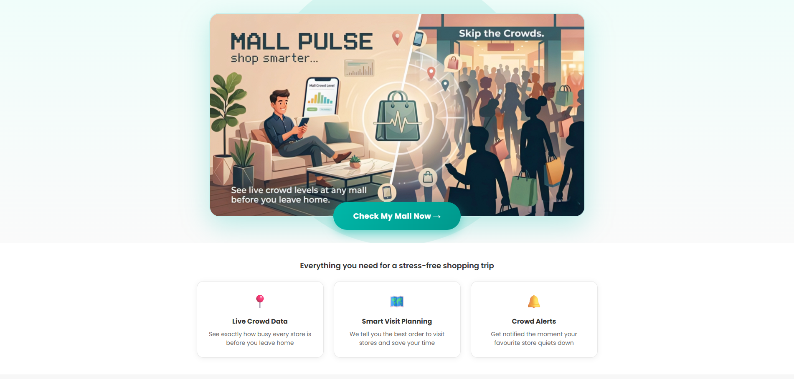
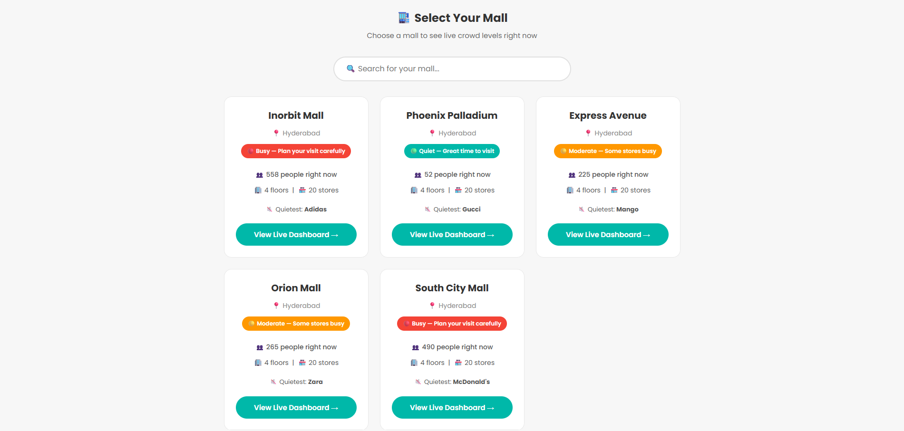
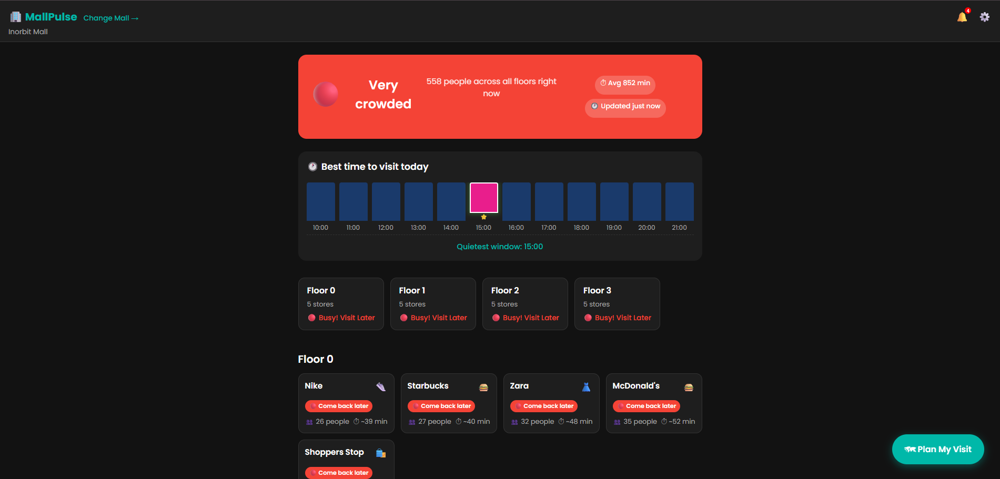
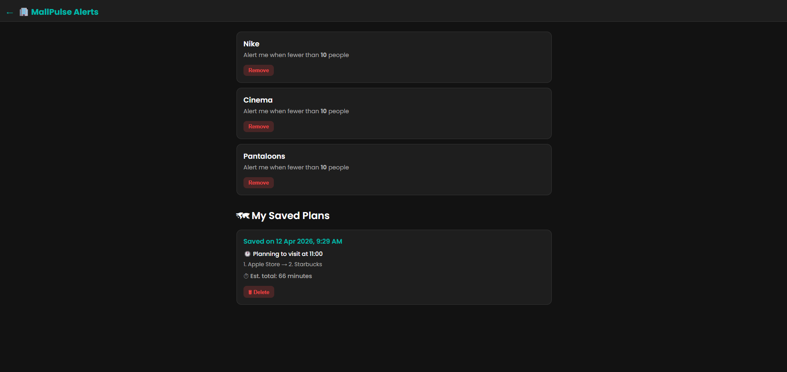
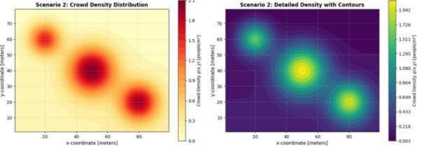
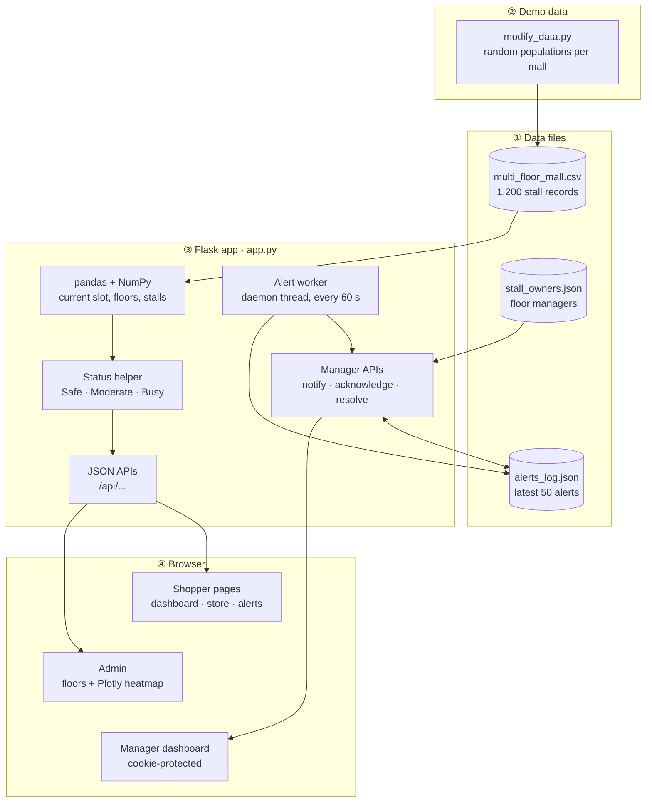

<div align="center">


# MallPulse

### Stall-level crowd data turned into shopper guidance, floor heatmaps and a live alert desk for mall managers

[](https://www.python.org)
[](https://flask.palletsprojects.com)
[](https://pandas.pydata.org)
[](https://plotly.com/python/)
[](#data-files)
[](#data-files)
[](#limitations-and-intended-use)

[At a glance](#at-a-glance) ·
[Features](#features) ·
[Screenshots](#screenshots) ·
[Architecture](#system-architecture) ·
[Quick start](#quick-start) ·
[API](#api-reference) ·
[Data](#data-files) ·
[Limitations](#limitations-and-intended-use) ·
[Roadmap](#roadmap)

<br/>



</div>

---

## At a glance

| | |
|---|---|
| **Problem** | Malls get crowded unevenly. Shoppers do not know when to visit, and managers learn about dangerous density late. |
| **Idea** | Track population per stall, roll it up to floors and malls, and serve it two ways: simple guidance for shoppers, and an alert desk for managers. |
| **Coverage** | 5 malls · 4 floors each · 12 hourly time slots (10:00 to 21:00) · 1,200 stall records |
| **For shoppers** | Mall crowd summary, floor heatmaps, per-store history, and the least crowded time to visit |
| **For managers** | Alert filtering, manual alerts, acknowledge and resolve flow, response-time statistics, floor-manager contacts |
| **Automatic alerts** | A background worker raises a **Stampede Risk** alert when a stall goes above 35 people in the latest time slot |
| **Stack** | Flask · pandas · NumPy · Plotly · vanilla JavaScript · CSV and JSON files |
| **Honest status** | Local demo. Data lives in files, login uses a hard-coded demo password, and debug mode is on by default. |

---

## Features

### For shoppers

| Feature | What it does |
|---|---|
| **Mall selection** | Pick from five malls and see each one's current crowd summary |
| **Floor density** | Floor-level population and status, with Plotly heatmaps of stall positions |
| **Store history** | Open any stall to see its population across all time slots |
| **Best time to visit** | Finds the least crowded time slot for a mall |
| **Status labels** | Every population is shown as Safe, Moderate or Busy! Visit Later |

### For managers

| Feature | What it does |
|---|---|
| **Alert desk** | Filter alerts by status, mall and floor |
| **Manual alerts** | Create an alert yourself, with an optional administrator message |
| **Acknowledge and resolve** | Track each alert from raised to resolved |
| **Statistics** | Alert counts and response-time numbers |
| **Floor contacts** | Floor-manager and stall-owner details from the owner directory |
| **Auto Stampede Risk** | Alert generated when a stall exceeds 35 people in the latest slot |

### For development

| Feature | What it does |
|---|---|
| **Demo data generator** | `modify_data.py` regenerates stall populations per mall, so each mall demonstrates a different crowd level |
| **JSON API** | Every view is backed by a documented endpoint (see [API reference](#api-reference)) |

---

## Screenshots

<p align="center">
  
  
</p>
<p align="center"><sub>Left: landing page and mall selection. Right: shopper dashboard with crowd summary.</sub></p>

<p align="center">
  
  
</p>
<p align="center"><sub>Left: shopper experience. Right: alert list with status, mall and floor filters.</sub></p>

<p align="center">
  
</p>
<p align="center"><sub>Left: manager dashboard. Right: MallPulse branding.</sub></p>

| Screen | What it shows |
|---|---|
| **Landing** (`/`) | Mall selection |
| **Dashboard** (`/dashboard`) | Mall and crowd information for shoppers |
| **Store** (`/store/<stall_id>`) | Population history for one stall |
| **Alerts** (`/alerts`) | Shopper-facing alert view |
| **Admin** (`/admin`) | Floor and heatmap view |
| **Manager** (`/manager`) | Protected operations dashboard |
| **Settings** (`/settings`) | Application settings |

---

## System architecture



**How a request flows**

- The app loads `multi_floor_mall.csv` with pandas and uses the earliest sorted time slot as the "current" slot for summary, floor and heatmap views.
- Stall history and the best-time endpoint use every available slot.
- A daemon thread checks for high-population stalls every 60 seconds and writes alerts straight to `alerts_log.json`, keeping the latest 50.
- Plotly figures are built on the server as JSON and drawn in the browser.

### Crowd status rules

The shared status helper classifies a population value like this:

| Population | Status |
|---|---|
| 0 to 5 | Safe |
| 6 to 15 | Moderate |
| 16 and above | Busy! Visit Later |

Manager alert severity uses a separate scale:

| Population | Severity |
|---|---|
| 0 to 15 | Warning |
| 16 to 25 | Critical |
| 26 and above | Stampede Risk |

> The automatic worker only raises alerts above 35 people. The severity scale applies to the alert once it exists.

---

## Project structure

```text
MallPulse/
├── app.py                    # Flask app: routes, APIs, alert worker
├── modify_data.py            # Regenerates demo stall populations
├── multi_floor_mall.csv      # Mall / floor / time-slot population dataset
├── alerts_log.json           # File-backed manager alert history
├── stall_owners.json         # Floor-manager and stall-owner directory
├── templates/                # Shopper, manager, admin and settings pages
└── static/
    ├── css/                  # Page styles
    ├── js/                   # Browser-side API and UI logic
    └── images/               # Landing-page assets
```

---

## Quick start

**Prerequisites:** Python 3.9 or newer, and `pip`.

### 1. Set up the environment

There is no dependency manifest yet, so install the packages directly.

**Windows (PowerShell)**

```powershell
python -m venv .venv
.\.venv\Scripts\Activate.ps1
python -m pip install --upgrade pip
python -m pip install Flask pandas numpy plotly
```

**macOS / Linux**

```bash
python3 -m venv .venv
source .venv/bin/activate
python -m pip install --upgrade pip
python -m pip install Flask pandas numpy plotly
```

### 2. Run the app

From the repository root (data paths are relative to the working directory):

```powershell
python app.py
```

Open **http://127.0.0.1:5000**.

If PowerShell blocks the activation script, run the interpreter directly:

```powershell
.\.venv\Scripts\python.exe app.py
```

### 3. Try the manager side

Go to `/manager-login` and use the demo password:

```text
manager123
```

The login sets a `manager_authenticated` cookie for one hour. This is a demo mechanism only.

### Page map

| URL | Purpose |
|---|---|
| `/` | Landing page and mall selection |
| `/dashboard` | Shopper dashboard |
| `/store/<stall_id>` | Store detail page |
| `/alerts` | Shopper alert view |
| `/settings` | Settings page |
| `/admin` | Admin floor and heatmap view |
| `/manager-login` | Manager login |
| `/manager` | Protected manager dashboard |

---

## API reference

All responses are JSON unless noted. Most mall-specific endpoints accept `?mall=<mall name>`.

### Shopper endpoints

| Method | Endpoint | Description |
|---|---|---|
| `GET` | `/api/malls` | List malls with current crowd summaries |
| `GET` | `/api/summary` | Total people, status and estimated dwell time |
| `GET` | `/api/floors` | Floor population and status summaries |
| `GET` | `/api/stalls` | Stall population records and statuses |
| `GET` | `/api/stall/<stall_id>` | A stall's time-slot history |
| `GET` | `/api/best-time` | The least crowded time slot |
| `GET` | `/api/heatmap/<floor>` | Plotly heatmap figure as JSON |

### Manager endpoints

| Method | Endpoint | Description |
|---|---|---|
| `POST` | `/api/manager/login` | Authenticate the demo manager |
| `GET` | `/api/manager/alerts` | List alerts; supports `status`, `mall` and `floor` filters |
| `POST` | `/api/manager/notify` | Create a manager alert |
| `POST` | `/api/manager/acknowledge/<alert_id>` | Acknowledge an alert |
| `POST` | `/api/manager/resolve/<alert_id>` | Resolve an alert |
| `GET` | `/api/manager/stats` | Alert and response-time statistics |
| `GET` | `/api/manager/floor-info` | Floor-manager information |

**Example requests**

```text
http://127.0.0.1:5000/api/summary?mall=Inorbit%20Mall
http://127.0.0.1:5000/api/floors?mall=Inorbit%20Mall
http://127.0.0.1:5000/api/stalls?mall=Inorbit%20Mall
```

---

## Data files

### `multi_floor_mall.csv`

1,200 records: five malls × four floors × twelve hourly slots from `10:00` to `21:00`.

| Column | Meaning |
|---|---|
| `mall_name` | Mall display name |
| `floor` | Numeric floor identifier |
| `time_slot` | Hourly slot such as `10:00` |
| `stall_id` | Store or attraction name |
| `x_coord`, `y_coord` | Stall position on the floor map |
| `stall_area` | Approximate stall or map area |
| `stall_population` | People currently associated with the stall |

### `alerts_log.json`

An object with an `alerts` array. Each alert records the mall, floor, stall, population, severity, timestamps, acknowledgement state, resolution state and an optional administrator message. Only the latest 50 alerts are kept.

### `stall_owners.json`

Mall-specific floor-manager and stall-owner details, used by the manager floor-info endpoint.

### Regenerating demo data

`modify_data.py` keeps the CSV schema and replaces every `stall_population` with a random value in a range set by mall:

| Mall | Population range | Resulting feel |
|---|---|---|
| Inorbit Mall, South City Mall | 16 to 35 | Busy |
| Express Avenue | 6 to 15 | Moderate |
| Phoenix Palladium, Orion Mall | 1 to 5 | Quiet |

```powershell
.\.venv\Scripts\python.exe modify_data.py
```

> This overwrites `multi_floor_mall.csv` in place. Commit or back up the file first if you want to keep the current values.

---

## Limitations and intended use

> **MallPulse is a local demo, not a production system.** Review these points before deploying it anywhere public.

- Authentication is a hard-coded demo password with a cookie, not real user management.
- The Flask server runs with `debug=True` by default.
- Alerts are written directly to `alerts_log.json`. Simultaneous writers or multiple processes can overwrite each other.
- Population data is generated by script, not read from live sensors or cameras.
- Plotly loads from a CDN in the browser, so heatmap pages need network access.
- There are no automated tests and no pinned dependency versions.
- No license file is included yet. Add one before distributing the project.

### Production checklist

1. Replace the demo password with a real user store, password hashing, authorization and server-side sessions.
2. Turn off `debug=True` and run behind a production WSGI server.
3. Add CSRF protection and validate every JSON field and numeric range.
4. Move alerts and mall data to a transactional database.
5. Use secure, HTTP-only, same-site cookies and HTTPS.
6. Add structured logging, error monitoring, rate limiting and backups.
7. Pin and regularly update dependencies.

---

## Roadmap

- [x] Five-mall dataset with floor and time-slot structure
- [x] Shopper dashboard, store history and best-time finder
- [x] Plotly floor heatmaps
- [x] Manager alert desk with acknowledge and resolve flow
- [x] Automatic Stampede Risk alerts from a background worker
- [ ] `requirements.txt` with pinned versions
- [ ] Automated tests for the status helper and API endpoints
- [ ] Real authentication and server-side sessions
- [ ] Database in place of CSV and JSON files
- [ ] Live data feed (sensors or camera counts) instead of generated values
- [ ] Vendor Plotly locally so heatmaps work offline

---

## Contributing

Run commands from the project root, since data paths are relative. If you change the CSV schema, update `modify_data.py` and the data table above together.

## License

No license is included yet. Add a `LICENSE` file (MIT is a common choice for demos) before sharing the code.

---

<div align="center">

**MallPulse** · Crowd awareness for shoppers and mall managers

*Local demo. Not for production use.*

</div>
